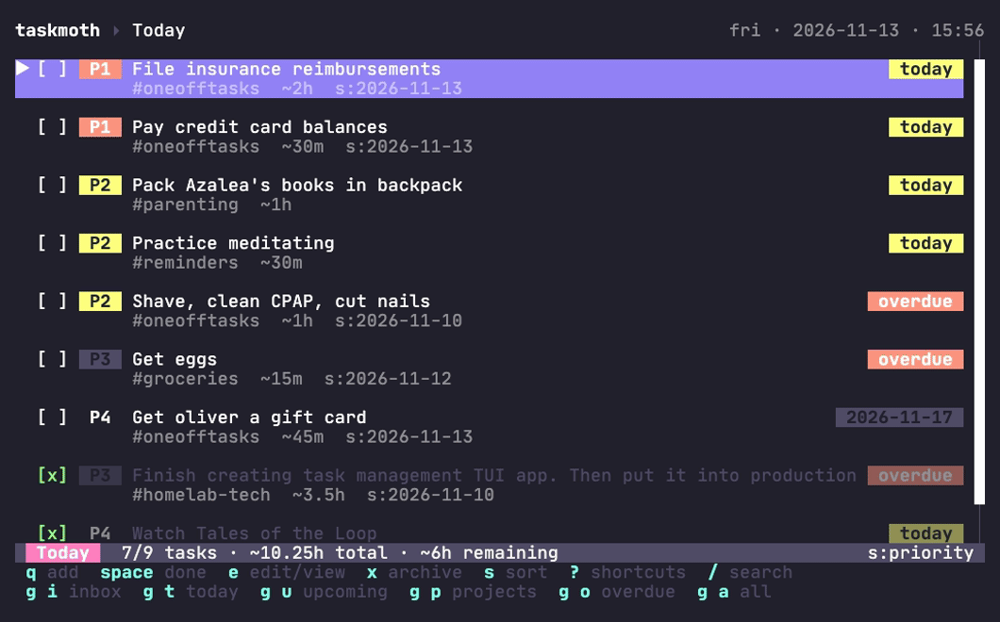
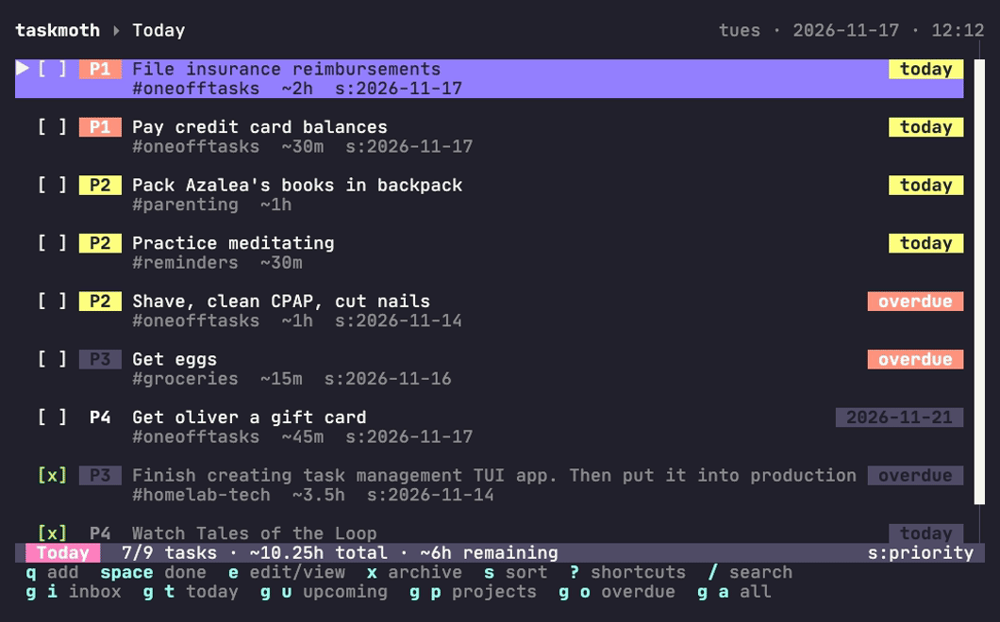
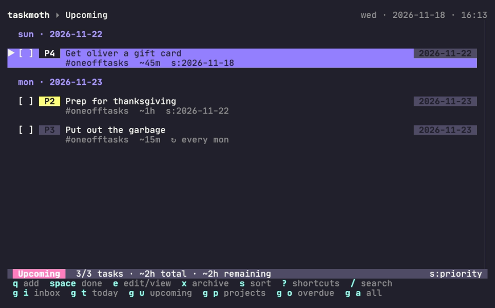
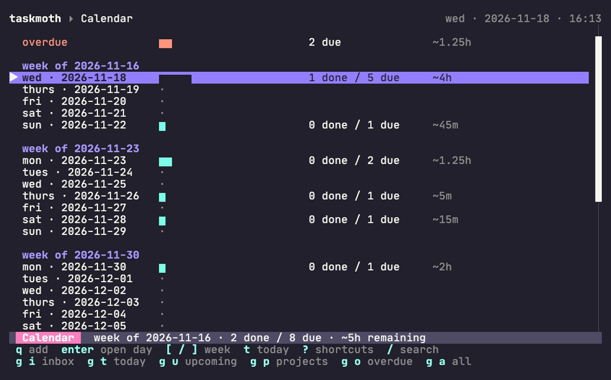
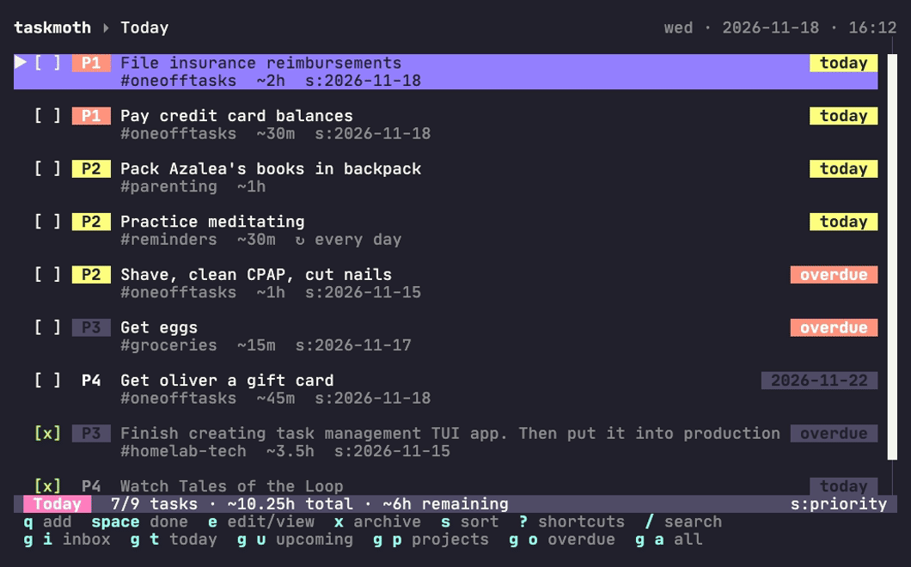
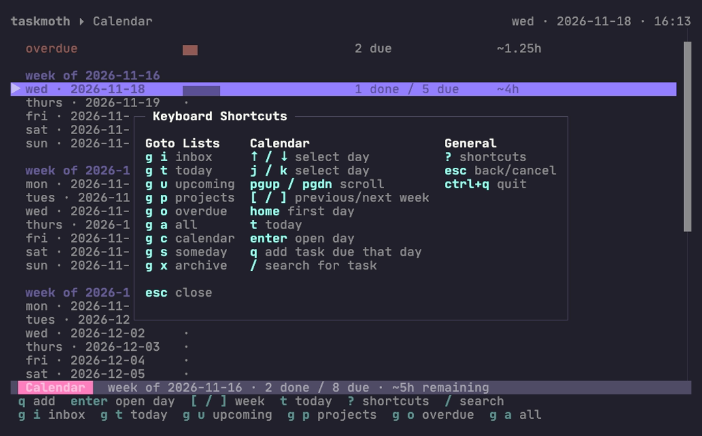
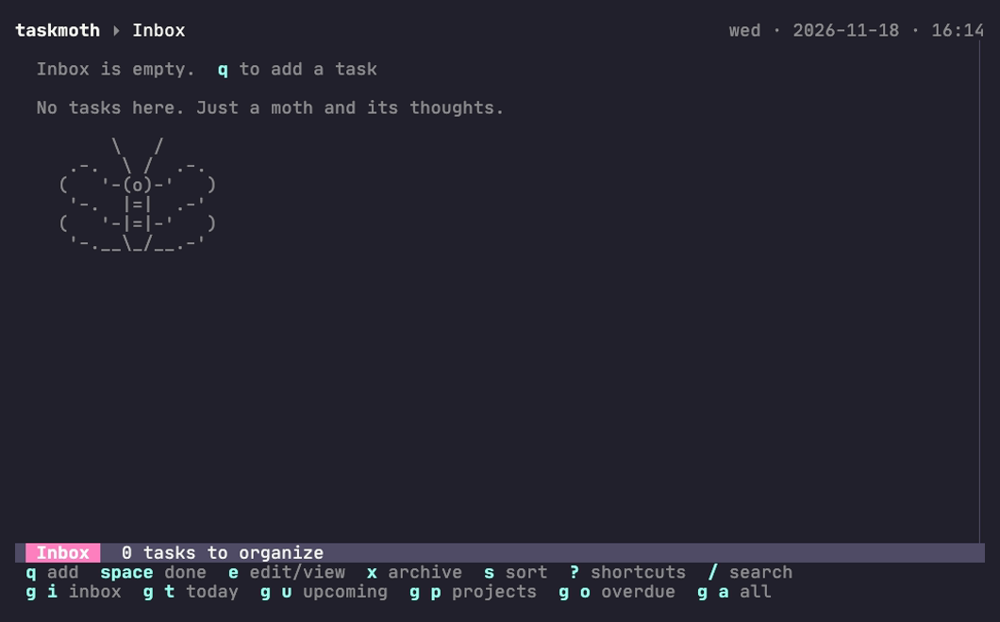
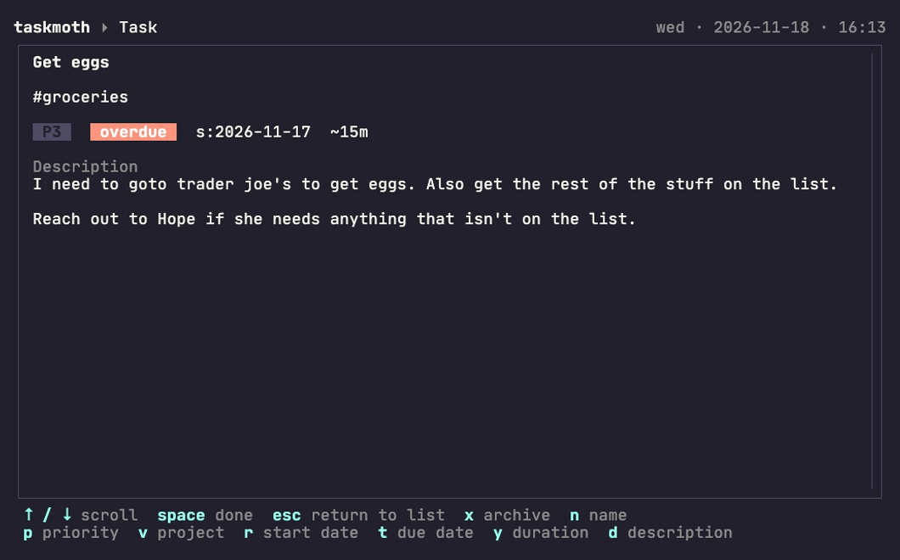

```text
 .--.  \ /  .--.     _                   _                          _     _
(    `-(@)-'    )   | |_    __ _   ___  | | __  _ __ ___     ___   | |_  | |__
 `-.  /|=|\  .-'    | __|  / _` | / __| | |/ / | '_ ` _ \   / _ \  | __| | '_ \
   (_/ |=| \_)      | |_  | (_| | \__ \ |   <  | | | | | | | (_) | | |_  | | | |
        V            \__|  \__,_| |___/ |_|\_\ |_| |_| |_|  \___/   \__| |_| |_|
```

<p align="center"><strong>A keyboard-driven task manager for the terminal.</strong><br>
Natural-language quick add, smart lists, instant search — all in a fast, local TUI built with <a href="https://github.com/charmbracelet/bubbletea">Bubble Tea</a>.</p>

<p align="center">
  <a href="https://github.com/azntaiji/taskmoth/releases/latest"></a>
  <a href="https://github.com/azntaiji/taskmoth/actions/workflows/ci.yml"></a>
  <a href="go.mod"></a>
  <a href="LICENSE"></a>
  
</p>

<p align="center">
  <a href="#install">Install</a> ·
  <a href="#usage">Usage</a> ·
  <a href="#quick-add">Quick add</a> ·
  <a href="#development">Development</a>
</p>

<p align="center"></p>

## Features

### Add tasks the way you'd say them

Press `q` and type. Dates, projects, priorities and durations are picked out as you go (Todoist-style), highlighted, and previewed before you commit. Project names autocomplete, typos get a "Did you mean #chores?", and new projects are created on the spot.

<p align="center"></p>

### Lists that sort themselves out

- **Today**: due, overdue or already started. **Upcoming**: the next 7 days, grouped by day. **Someday**: everything without a due date.
- **Overdue**, **Inbox**, **All**, the **Archive**, and a list per **#project**, each a `g` chord away. `g p` lists your projects; type to filter them.
- Two-line rows with priority and due badges, duration and start date. The status bar totals the time left in the view.
- `s` cycles the sort (priority, due, start, duration, name), remembered per view.
- `o` groups Today, All, Someday, Overdue and project lists under headers: by project, priority, due date or duration (each list offers the ones that make sense). Also remembered per view.
- `c` cycles completed tasks in every list: today's (dimmed, until midnight), all of them, or hidden. The choice is remembered.

<p align="center">
  
  
</p>

### Repeat it

Write the repeat the way you'd say it: `Water plants every mon and thu`, `Pay rent every 1st`, `Book club every first mon`, `Bins every other thursday`, `Anniversary every nov 20`, `Daily standup`. Rows show `↻ every mon, thu`. Completing one keeps it as done and adds the next one, so the Calendar's done counts stay true; the status bar says when it's next due. To change or stop a repeat, edit the due date (`t`): type a new rule, a date to move just this one, or clear it.

### Plan your week without over-assigning

`g c` opens the **Calendar**: every day from today on, one line each, with a bar and a count of the tasks due that day (`1 done / 5 due`) and the time still estimated. Weeks have headers, the status bar totals the selected week, and overdue tasks sit in a row at the top. `enter` opens a day's tasks, and `q` adds a task due on the selected day. While you set a due date, in Edit Due date or with `@` in quick add, the dialog shows how many tasks that day already has.

<p align="center"></p>

### Find anything as you type

`/` searches names, descriptions and project names, with words in any order. Narrow it down with `#project`, `#inbox` or `!p1`–`!p4`. Press `enter` to work on the results with the usual keys.

<p align="center"></p>

### Every field is one key away

`e` opens a task with its description. From there, or straight from any list, single keys edit the name (`n`), description (`d`), project (`v`), start date (`r`), due date (`t`), duration (`y`) and priority (`p`). Dates and durations take natural language too: `next friday`, `1.5h`.

<p align="center"></p>

### Keyboard first, and it tells you the keys

Hint rows at the bottom of every screen, and `?` for the full map. Arrows or `j`/`k`, `space` to complete, `x` to archive (nothing is deleted without going through the archive first).

<p align="center"></p>

### And a little personality

An empty Inbox, Someday list or project gets a moth and a note for the day. Clear out Today and the status bar gives you a (usually moth-related) pat on the back.

<p align="center">
  
  
</p>

### Under the hood

- **Local and private**: one SQLite file in `~/.local/share/taskmoth`, no account, no network. Automatic backups before upgrades.
- **Your data, portable**: `taskmoth --export csv` or `--export json` prints every task and project, ready for a spreadsheet or `jq`.
- **Fast**: stays instant with thousands of tasks.
- **Your terminal's colours**: the default theme draws with the 16 ANSI colours of your terminal's own scheme, light or dark, and its own background. Prefer the look in the screenshots everywhere? Switch to the built-in Dracula theme (see [Settings](#settings)).
- **Works anywhere**: macOS and Linux, Intel and ARM, over SSH and inside tmux. True colour, 256-colour and 16-colour terminals, and an `--ascii` mode for minimal fonts.
- **Designed first**: every screen was built from a Figma design, with colours from design tokens mapped onto the ANSI palette.

### Planned

A Homebrew tap, times of day, user themes, time tracking and analytics. See [PLAN.md §7](PLAN.md#7-future-features-out-of-scope).

## Install

taskmoth runs on macOS and Linux (Intel and ARM). It needs a terminal of at least 80×24.

### From a GitHub release

Each [release](https://github.com/azntaiji/taskmoth/releases) has a `.tar.gz` per platform and a `checksums.txt`. Pick the archive for your machine:

| Machine | Archive |
|---|---|
| Mac with Apple silicon (M1 and later) | `taskmoth_<version>_darwin_arm64.tar.gz` |
| Intel Mac | `taskmoth_<version>_darwin_amd64.tar.gz` |
| Linux on x86-64 | `taskmoth_<version>_linux_amd64.tar.gz` |
| Linux on ARM64 (e.g. Raspberry Pi 4/5 with a 64-bit OS) | `taskmoth_<version>_linux_arm64.tar.gz` |

Then, for example on an Apple silicon Mac (replace the version and platform):

```sh
VERSION=1.0.0
curl -LO https://github.com/azntaiji/taskmoth/releases/download/v$VERSION/taskmoth_${VERSION}_darwin_arm64.tar.gz
curl -LO https://github.com/azntaiji/taskmoth/releases/download/v$VERSION/checksums.txt
shasum -a 256 --ignore-missing -c checksums.txt   # on Linux: sha256sum --ignore-missing -c checksums.txt
tar xzf taskmoth_${VERSION}_darwin_arm64.tar.gz
mkdir -p ~/.local/bin && mv taskmoth ~/.local/bin/   # or any directory on your PATH
taskmoth --version
```

To upgrade, repeat with the new version. Your tasks stay where they are.

**macOS and browser downloads:** the binaries aren't signed by Apple. Downloaded with `curl` as above, they run as is. If you download the archive in a browser instead, macOS blocks the first run ("Apple could not verify…"). Clear the flag with `xattr -d com.apple.quarantine ~/.local/bin/taskmoth`, or allow it under System Settings → Privacy & Security.

### With Go

With Go 1.26 or later:

```sh
go install github.com/azntaiji/taskmoth/cmd/taskmoth@latest
```

This puts `taskmoth` in `$(go env GOPATH)/bin`. Run the same command to upgrade. `@latest` installs the newest release; use `@main` instead for the latest unreleased changes.

## Usage

```sh
taskmoth                    # start the app
taskmoth --data DIR         # use DIR for the database instead of the default
taskmoth --ascii            # ASCII symbols for minimal fonts/terminals (or TASKMOTH_ASCII=1)
taskmoth --export csv       # print every task as CSV (or json) and exit
taskmoth --export json --output tasks.json   # write the export to a file
taskmoth --version          # print the version
```

Quit with `ctrl+q` or `ctrl+c` (`q` is "add task"). Press `?` for every key.

| Key | Action |
|---|---|
| `↑`/`↓`, `k`/`j` | move the selection |
| `pgup`/`pgdn` | move by a page |
| `home`/`end`, `g g`/`G` | jump to top/bottom |
| `q` | add a task (quick add; see below); from a project's list it goes to that project |
| `e` | open the selected task (`esc` returns to the list) |
| `n` `d` `v` `r` `t` `y` `p` | edit name, description, project, start date, due date (or repeat: `every friday`), duration, priority |
| `space` | complete (then select the next open task) / reopen the selected task |
| `s` | cycle the sort (priority → due → start → duration → name) |
| `o` | cycle grouping: Today by project → priority → duration; All, Someday and Overdue by project → priority → due → duration; projects by priority → due → duration; then none |
| `c` | cycle completed tasks in every list: today's → all → hidden (Today, Upcoming and Overdue only ever show today's) |
| `x` | archive the selected task (in the Archive: delete forever) |
| `u` | unarchive (in the Archive) |
| `g t` `g i` `g u` `g o` `g s` `g a` `g x` | Today, Inbox, Upcoming, Overdue, Someday, All, Archive |
| `g c` | Calendar: `↑`/`↓` or `j`/`k` pick a day, `[`/`]` a week, `t` today, `enter` open the day (`esc` returns), `q` add a task due that day |
| `g p` | Goto Project: type to filter, `enter` open, `ctrl+n` new project, `ctrl+x` archive, `ctrl+u` unarchive, `esc` clear the filter / close |
| `/` | search (see below) |
| `?` | keyboard shortcuts (`esc` or `?` closes) |
| `esc` | cancel a pending `g`, close a dialog, or go back |

Dialogs use `←`/`→` to choose a button and `enter` to confirm. In edit dialogs, an empty value clears the field (`no date` also clears a date), and Edit Project's "Inbox" entry removes the project. In Edit Description, `shift+enter` (where the terminal supports it), `alt+enter` or `ctrl+j` adds a line break.

### Settings

Settings live in `~/.config/taskmoth/config.toml` (or `$XDG_CONFIG_HOME/taskmoth/config.toml`). The file is optional:

```toml
# Colour theme:
#   "default"  your terminal's own ANSI colours and background
#   "dracula"  taskmoth's Dracula palette in 24-bit colour, the same in every terminal
theme = "dracula"
```

`TASKMOTH_THEME=dracula` overrides the file for one run. An unknown theme or setting stops taskmoth with a message naming the file, so a typo never goes unnoticed.

In the default theme, dimmed text (completed tasks, the view behind a dialog) uses your terminal's "faint" style. The Dracula theme blends real colours instead.

The default theme is tested with Dracula, Nord, Solarized Light and Dark, Catppuccin Latte and the stock iTerm2 and Ghostty schemes. One known limitation: iTerm2's built-in **Solarized Dark** preset sets "bright black" to the background colour, which hides the P3 badge. Ghostty's copy of the scheme (and most ports) doesn't, or use `theme = "dracula"`.

### Your data

Everything lives in one SQLite file, `taskmoth.db`, in `~/.local/share/taskmoth` (or `$XDG_DATA_HOME/taskmoth`, or the `--data` directory). To back it up, copy that directory while taskmoth isn't running.

- **Before a new version upgrades the database**, taskmoth saves a copy next to it (`taskmoth.db.bak-v<schema>-<date>`) and keeps the three newest.
- **Only one taskmoth runs per database.** A second one exits with "already running" rather than risk overwriting the first one's changes.
- **If the file is damaged** (or was written by a newer taskmoth), taskmoth stops with a message naming the file and the newest backup, and leaves the file untouched. To restore a backup, quit taskmoth and copy the backup over `taskmoth.db`.

### Export

`taskmoth --export csv` or `taskmoth --export json` prints every task, open, completed and archived, to standard output; add `--output FILE` to write a file instead. It works while taskmoth is open.

- **JSON** has a `projects` array and a `tasks` array; each task carries its `project_id` and `project` name.
- **CSV** has one row per task: `id,name,description,project,priority,start,due,duration_min,created_at,updated_at,completed_at,archived_at,repeat,series_id`.
- `repeat` is the rule in words (`every mon, wed`), and `series_id` links every occurrence of a repeating task.
- Dates are `YYYY-MM-DD`, timestamps are RFC 3339 in UTC, and durations are in minutes. Unset values are `null` in JSON and empty in CSV.

```sh
taskmoth --export json | jq '.tasks[] | select(.completed_at == null and .priority == 1) | .name'
```

### Search

`/` opens Search with the query input in the status bar. Every word must appear, in any order, in a task's name, description or project name; `#work` keeps tasks in projects starting with "work", `#inbox` keeps tasks with no project, and `!p1`–`!p4` filter by priority. Archived tasks aren't searched; completed ones are listed last.

While typing, `↑`/`↓` move the selection. `enter` moves to the results, where the usual list keys work (`e`, `space`, `x`, `p`, …); `/` or `esc` returns to the input, and `esc` there goes back to the previous view. The last query is kept until you quit.

### Quick add

Type the task name. Anything taskmoth recognises is highlighted and shown in the preview line. With a due date, the line under it shows how many tasks are already due that day (`thurs · 2026-11-12 · 1 done / 4 due`).

| Write | Sets |
|---|---|
| `tomorrow`, `friday`, `next week`, `in 3 days`, `nov 20`, `27th`, `end of month`, `2 days before nov 20`, `11/20`, `2027-04-15` | due date (the `@` prefix is optional: `@tom`, `@sun`) |
| `s:monday`, `s:tomorrow` | start date |
| `#project` | project (`tab` completes; an unknown name asks before creating it) |
| `p1`–`p4` or `!p1`–`!p4` | priority (default P4) |
| `~30m`, `~1.5h`, `~1h30m`, `~2 hours` | estimated duration |
| `every day`, `every mon, wed`, `every other week`, `every 3 days`, `every weekday`, `every 15th`, `every last day`, `every first mon`, `every nov 20`, `ev 2 weeks`, `daily`, `weekly`, `… starting jan 1` | repeat, and the first due date unless one is given |

If something is recognised by mistake ("Pay may 5 bill"), put the cursor on it and press `ctrl+t` to keep it as text, or type `\` before the word. Times (`at 4pm`) stay in the name. The full grammar is [PLAN.md Appendix A](PLAN.md#appendix-a-quick-add-grammar-g51-approved-2026-11-12).

## Development

Requirements: Go 1.26+ and make. There is no cgo; SQLite is pure Go (`modernc.org/sqlite`).

```sh
make build     # bin/taskmoth
make run       # go run ./cmd/taskmoth (ARGS="--data /tmp/tm")
make gallery   # widget gallery
make test      # go test ./...
make golden    # rewrite golden render files after an intended visual change
make lint      # golangci-lint v2 (fetched with go run)
make check     # build + vet + test + lint: must pass before a change is done
make release-check  # validate the GoReleaser config and build every release archive into dist/
make demo           # re-record the README's GIFs and screenshots with VHS (brew install vhs)
```

The README's images live in `docs/images`. The GIFs and screenshots are recorded from scripts in `docs/tapes` with [VHS](https://github.com/charmbracelet/vhs), using the sample data in a scratch directory, so `make demo` reproduces them after a UI change. The logo at the top is plain ASCII text in the README itself.

Developer flags, hidden from `--help`: `--seed` loads the sample data from the designs into an empty data directory, `--list VIEW` prints a view (`today`, `upcoming`, `overdue`, `inbox`, `someday`, `all`, `completed`, `archive`, `project:<name>`), and `--gallery` shows the widget gallery. Always point them at a scratch directory, e.g. `taskmoth --data /tmp/tm --seed`.

**Releases** are built by [GoReleaser](https://goreleaser.com) in `.github/workflows/release.yml` when a `vX.Y.Z` tag is pushed. The release notes list the commit subjects since the previous tag.

The code is laid out as:

```
cmd/taskmoth/        entry point and flags
internal/paths/      XDG data and config directories
internal/config/     config.toml (theme)
internal/lock/       single-instance lock on the data directory
internal/task/       domain model, view filters, sorting, grouping, per-day counts (pure; no UI or storage)
internal/nlp/        quick-add parser, date phrases, durations (pure)
internal/store/      SQLite store, migrations, integrity check and backups, in-memory store for tests
internal/export/     CSV and JSON export
internal/seed/       sample data from the designs
internal/ui/         app model, key map, dialogs, Add Task, task view, Search, shortcuts
internal/ui/view/    list views (Today, Inbox, …) and the Calendar
internal/ui/theme/   colour tokens (palette → semantic), the default (ANSI) and Dracula palettes, dimmed theme, glyphs
internal/ui/widget/  widgets built from the Figma Components page
internal/ui/gallery/ developer gallery
docs/images/         README screenshots and GIFs, logo icon (SVG)
docs/tapes/          VHS scripts that record the screenshots and GIFs
```

### Contributing

- Read [AGENTS.md](AGENTS.md) for working conventions and [PLAN.md](PLAN.md) for the phased plan. Any change to user-visible behaviour, the data format or key bindings is a decision that gets recorded in the PLAN.md decision log.
- The UI is implemented from Figma designs, and each screen's node is listed in PLAN.md §3. Colours come only from `theme.Colors`, and glyphs only from `theme.Glyphs`.
- Changes to the database schema go in a new numbered file in `internal/store/migrations/`. Never edit a released migration.
- CI runs build, vet, race-enabled tests and lint on macOS and Ubuntu.
- Versions follow [Semantic Versioning 2.0.0](https://semver.org/) and are released as git tags (`vX.Y.Z`); the version badge shows the latest tag. Until 1.0.0, each completed phase bumps the minor version (Phase 5 → 0.5.0) and fixes bump the patch.

## License

[MIT](LICENSE)
